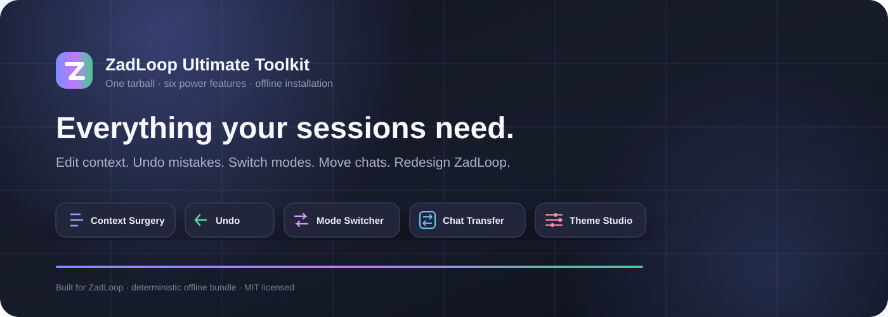
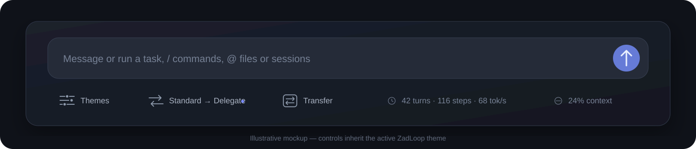
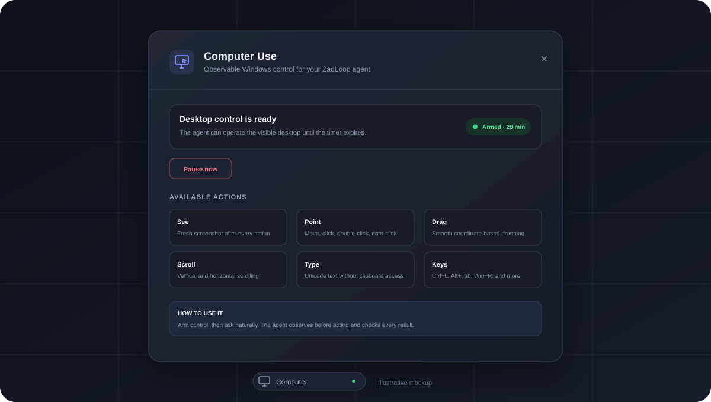
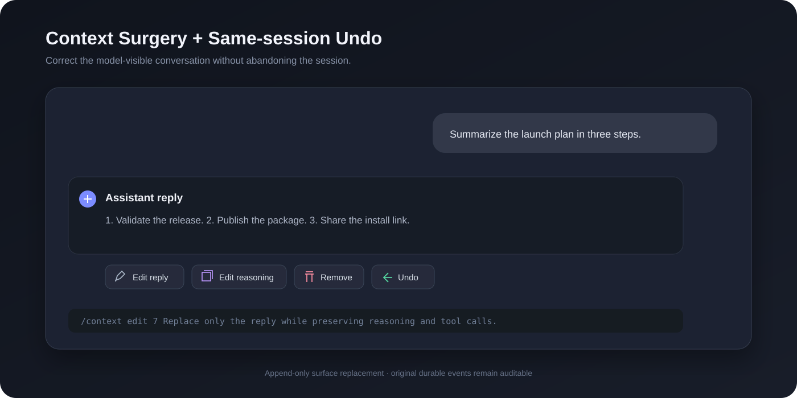
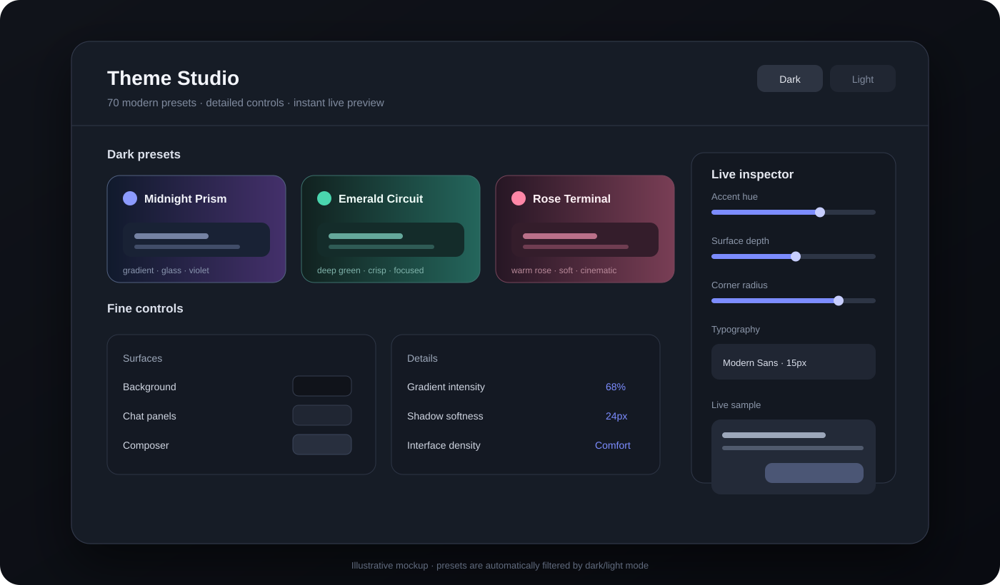
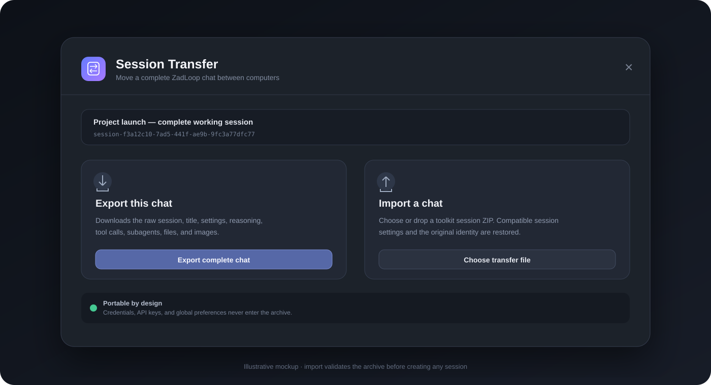

<div align="center">
  

  # ZadLoop Ultimate Toolkit

  **One tarball. Six integrated tools. No plugin hunting.**

  
  
  
  
  [](https://github.com/Lucifer-xD/zadloop-ultimate-toolkit/actions/workflows/ci.yml)
</div>

ZadLoop Ultimate Toolkit packages Computer Use, Context Surgery, same-session Undo, live session mode switching, full chat transfer, and Theme Studio into **one self-contained plugin file**. Its dependencies are bundled inside the release, so your friends install a single `.tgz` rather than finding separate packages.

> Community project. Not affiliated with or endorsed by DeepSeek or ZadLoop.

## What is included

| Feature | What it does | Included version |
|---|---|---:|
| Computer Use | Let a vision-capable agent see and operate the visible Windows desktop with screenshots, mouse, keyboard, scrolling, and an expiring arm switch | 1.0.1 |
| Context Surgery | Edit reply text, edit reasoning separately, remove messages from future model context, and use `/context` commands | 0.1.2 fixed-v4 |
| Same-session Undo | Remove one user/assistant exchange from the transcript and future context without creating a new session | 1.5.1 |
| Mode Switcher | Change the **current session** between Standard and Delegate mode | 2.0.3 |
| Session Transfer | Export/import a complete chat with title, events, settings, subagents, files, and images | 1.0.2 |
| Theme Studio | 50 dark + 20 light mode-exclusive themes, gradients, detailed controls, and a live preview | 5.0.3 |
| Offline dependencies | Bundled runtime packages, including `fflate`; no npm lookup is required during tarball installation | bundled |



## Install

### ZadLoop interface

1. Download [`dsh-zadloop-ultimate-toolkit-1.1.0.tgz`](https://github.com/Lucifer-xD/zadloop-ultimate-toolkit/releases/latest/download/dsh-zadloop-ultimate-toolkit-1.1.0.tgz) from the latest GitHub release.
2. If standalone copies are installed, disable or uninstall these first to avoid duplicate buttons:
   - `@wasd258/dsh-context-surgery`
   - `dsh-zadloop-undo`
   - `dsh-zadloop-mode-switcher`
   - `dsh-zadloop-computer-use`
   - `dsh-zadloop-theme-studio`
   - `dsh-zadloop-session-transfer`
3. Open **Plugins → Add plugin → Tarball**.
4. Select the downloaded toolkit `.tgz`.
5. Let ZadLoop hot-load it. Restart only if your ZadLoop build explicitly asks you to.

### Command line

```powershell
cd "$env:APPDATA\ZadLoop\harness\profiles\web"
pnpm add "C:\path\to\dsh-zadloop-ultimate-toolkit-1.1.0.tgz"
```

Add `dsh-zadloop-ultimate-toolkit` once to `dsh.profile.bundles` if your package manager does not do that automatically.

## Feature guide

### Computer Use

Open **Computer** in the bottom dock and choose **Arm computer control**. It starts paused, can be armed for 15, 30, 60, or 120 minutes, expires automatically, and can be stopped immediately with **Pause now**.

Then ask naturally, for example:

- “Open Settings and enable Night light.”
- “Use the browser to download my latest invoice.”
- “Open this spreadsheet and sort the table by date.”

The model receives a new screenshot after every action and can move, click, double-click, right-click, drag, scroll, type Unicode text, and press shortcuts such as `CTRL+L` or `ALT+TAB`. Coordinates remain accurate on scaled and multi-monitor desktops.



Use a vision-capable model. Supervise consequential work and pause before passwords, payments, account changes, or other sensitive actions.

### Context Surgery

Use the actions under an assistant message:

- **Edit reply** changes visible reply text while preserving reasoning and tool calls.
- **Edit reasoning** changes only the reasoning stream.
- **Remove** shadows that message from the model-visible context through an append-only surface replacement.
- `/context list`, `/context edit`, `/context think`, `/context clear-think`, `/context rewrite`, `/context delete`, and `/context replace` provide command-level control.



Context Surgery is powerful: it changes what the model sees on its next request. The original durable log is retained for auditability.

### Same-session Undo

Click **Undo** beside an exchange. The selected user message and its reply are removed from the visible transcript and future model context while the session ID stays unchanged.

Undo does **not** reverse file edits, commands, deployments, or other external side effects.

### Standard ↔ Delegate mode

The compact dock control shows the current and target mode, for example `Standard → Delegate`. Clicking it recomposes the existing live agent and records `agent-preset/selected`; it does not start a new session.

### Theme Studio

Open **Themes** from the bottom dock. Choose from 70 mode-aware presets or tune typography, surfaces, accents, radii, density, shadows, gradients, and chat colors with an always-live preview.



- Dark presets appear only in dark mode.
- Light presets appear only in light mode.
- Every preset recolors the background, panels, composer, messages, text, borders, and interactive states—not just the wallpaper.

### Transfer a complete chat

1. Open the chat you want to move.
2. Click **Transfer → Export complete chat**.
3. Copy the resulting `.zadloop-session.zip` to the other PC or RDP.
4. Install this toolkit there.
5. Click **Transfer → Choose transfer file** and select the ZIP.



The archive preserves the session title and identity, model/mode/access events, full conversation, reasoning, tool calls/results, subagent sessions, files, and images. Import refuses to overwrite an existing session ID.

Machine-wide credentials, API keys, provider logins, and global preferences are intentionally excluded. Configure those separately on the destination computer.

## Practical examples

See [examples/WORKFLOWS.md](examples/WORKFLOWS.md) for complete workflows:

- Correct a bad assistant answer without losing tool calls.
- Undo a mistaken exchange and resend a corrected prompt.
- Switch a long-running session between Standard and Delegate.
- Move a session from a PC to an RDP.
- Build matching dark and light visual profiles.

## Safety and privacy

- No telemetry is added by this toolkit.
- Session Transfer writes only to local ZadLoop session/attachment storage.
- Imported archives are checked for traversal paths, encryption, ZIP64, entry count, compressed size, expanded size, valid JSONL, contiguous event sequences, duplicate session IDs, and attachment integrity.
- Context edits and Undo are append-only. They change the model-visible surface rather than erasing the durable log.
- Context Surgery exposes loopback-only local API routes. Any trusted local process can reach loopback, so use ZadLoop on a trusted machine.
- Computer Use is Windows-only, starts paused after every host start or plugin reload, never persists an arm grant, and exposes fixed desktop actions rather than arbitrary command execution.
- Pausing Computer Use terminates an in-flight desktop action. Its screenshots are stored by ZadLoop as normal session attachments so the model can inspect them.

## Compatibility

Validated with:

- ZadLoop 0.5.1
- DSH 0.2.0-rc.2
- Node.js 22.19 or newer
- Windows desktop web profile

The clean-profile smoke test installs only this tarball, resolves every bundled feature through DSH's runtime package router, and boots a separate web host on an OS-assigned port. Computer Use additionally requires Windows and a model route that accepts image input.

## Development

```powershell
npm ci --ignore-scripts
npm test
npm run check
npm pack
```

The release package uses npm `bundledDependencies`. The `vendor/` archives make builds deterministic and keep installation offline. The complete Computer Use source, Windows worker, client panel, and tests live in [`packages/computer-use`](packages/computer-use/).

See [docs/ARCHITECTURE.md](docs/ARCHITECTURE.md), [CONTRIBUTING.md](CONTRIBUTING.md), and [SECURITY.md](SECURITY.md).

## Credits

- Context Surgery is based on [WASD258-jpg/dsh-context-surgery](https://github.com/WASD258-jpg/dsh-context-surgery), licensed under MIT.
- Context surface replacement follows the same append-only mechanism used by DeepSeek Harness compaction.
- Full attribution is in [THIRD_PARTY_NOTICES.md](THIRD_PARTY_NOTICES.md).

## License

MIT. See [LICENSE](LICENSE).
